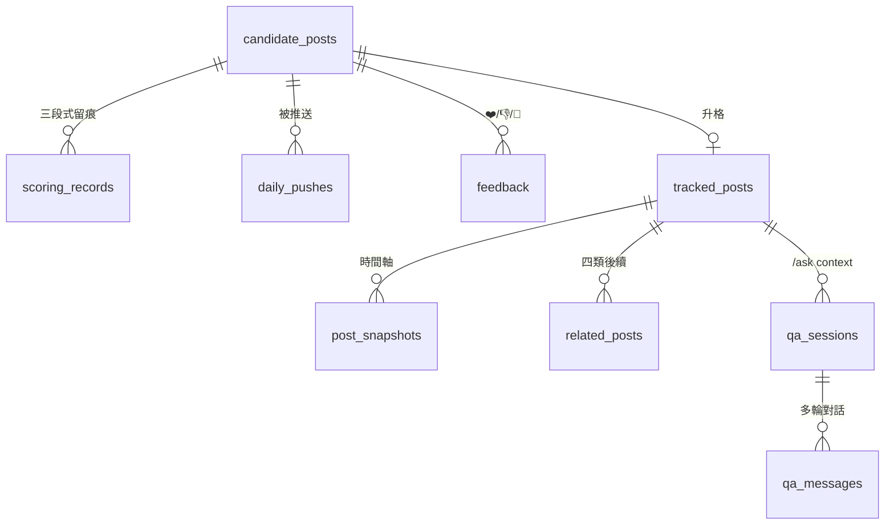

<!-- _paginate: false -->
<!-- _header: '' -->
<!-- _footer: '' -->

# Reddit Tracker
## 素人爆文發現、追蹤與問答系統

<br>

**組員 / Team Members**
- B11202xxx　○○○
- B11202xxx　○○○
- B11202xxx　○○○

<br>

<span class="small">資料庫課程期末 Demo　·　2026 春季學期</span>

---

## 簡報大綱 / Outline

1. **Introduction** — 研究動機、目標、兩次 pivot
2. **Database Design** — 12 表 schema、四群關係、設計取捨
3. **Implementation** — 五層 pipeline、Scheduler、技術棧、Plan C
4. **Conclusion** — 評估數字、限制、未來工作
5. **References** — 參考文獻與專案文件

---

# 1. Introduction
## 簡介

---

## 1.1 研究動機

**社群每天都有「素人意外爆文」**，讀者當下被吸引、心裡想「後來呢？」——
但這些貼文不在追蹤清單，極容易**錯過後續發展**。

<br>

> **核心命題**：能不能用一條自動化流水線，
> 把「**素人爆文 → 後續事件 → 重量 context 問答**」這條鏈打通？

<br>

<div class="tight">

- 探索：每天從哪些社群、用什麼條件挑出值得看的貼文？
- 評分：怎麼讓系統判斷「這篇可能會爆 / 有後續價值」？
- 追蹤：收藏後怎麼自動偵測作者新貼、高分回應、被引用？
- 問答：累積到的時間軸 + 留言樹，能不能用 LLM 開放式回答？

</div>

---

## 1.2 研究目標

<div class="tight">

**主要目標**

1. **自動化探索 + 評分流水線** — 15 個 subreddit（5 中 + 10 英）+ 20 個雙語 keyword 種子，每日 Top 5 候選
2. **Telegram Bot 每日推送** — inline button 三選一（❤️ / 👎 / 🔕）
3. **長期追蹤 + 四類後續偵測** — 作者新貼 / 作者留言 / 高分回應 / crosspost
4. **對話式問答 `/ask <id>`** — 重量 context（原貼 + snapshots + 完整 comment tree + related events）多輪 LLM 對話

**次要目標**

5. 探討「演算法評分」與「使用者收藏行為」相關性
6. 重量 context（12k–45k tokens）下 LLM 問答品質
7. 建立**中英對照**素人爆文資料集（去識別化）

</div>

---

## 1.3 兩次 Pivot — 從 Threads 到 Reddit，再從 .json 到 RSS

| 階段 | 觸發 | 決策 |
|------|------|------|
| **v3 → v4** | Threads scraper 月成本 $246、cookie 認證風險、留言 flat 難追 | 整段重建到 Reddit：免費 API、樹狀留言、subreddit 是天然主題容器 |
| **Plan C** | 2026-05-29 Reddit 擋住 anonymous `.json` | 切到 **RSS feed 主導 + public JSON fallback**，月成本實測 **$1.5**（vs 預估 $15–36，**便宜 10×**） |

<br>

**啟示**：研究命題不變，**資料層可以替換**。OAuth 申請中，通過後可一行切回 PRAW。

---

# 2. Database Design
## 資料庫設計

---

## 2.1 整體：12 張表，分四群

| 群組 | 表 | 用途 |
|------|----|------|
| **探索** | `candidate_posts` · `subreddit_sources` · `keyword_seeds` | 候選池 + 探索種子 |
| **評分推送** | `scoring_records` · `daily_pushes` · `feedback` | 三段式評分 + 推送記錄 + 使用者回饋 |
| **收藏追蹤** | `tracked_posts` · `post_snapshots` · `related_posts` | 升格池 + 時間軸快照 + 四類後續事件 |
| **LLM 與問答** | `llm_records` · `qa_sessions` · `qa_messages` | LLM 用量對帳 + 多輪對話 |

<br>

> 完整 ER 圖見 [`docs/v4_schema.md`](v4_schema.md)；Alembic migrations 從 0 → 2 revision。

---

## 2.2 核心關係（ER 圖）



<br>

**狀態機要點**
- `candidate → tracked` 由 feedback.action='collect' 升格（首位使用者寫 owner）
- `tracked.polling_tier`：hot=15 min / cooling=1 h / archive=6 h；> 30 d 終止
- `related_posts` 三元組 UNIQUE `(tracked_post_id, relation_type, reddit_post_id)` 防重複

---

## 2.3 設計取捨

<div class="tight">

**跨資料庫相容**
- `BigInteger().with_variant(Integer(), "sqlite")` — BigInt PK 在 SQLite 不會 auto-increment 的坑直接避開
- JSON 欄位用 SQLAlchemy `JSON` type：Postgres → JSONB / SQLite → TEXT，零客製
- 所有 timestamp 一律 `DateTime(timezone=True)` 存 UTC

**SQLite 並發** — 從事故學到的（2026-06-09 ~ 11 連 3 天 daily push 死在 lock）
- `journal_mode=WAL` + `synchronous=NORMAL` + `busy_timeout=5000`
- WAL 讓 reader / writer 不互相 block；只有 writer 之間 mutex

**索引設計**
| 表 | 索引 | 理由 |
|----|------|------|
| `candidate_posts` | `(reddit_post_id)` UNIQUE | 去重 |
| `daily_pushes` | `(push_date, candidate_post_id)` UNIQUE | 每日防重複 |
| `tracked_posts` | `(polling_tier, last_polled_at)` | 分級輪詢調度 |
| `related_posts` | `(tracked_post_id, relation_type, reddit_post_id)` UNIQUE | 三元組防重 |

</div>

---

# 3. Implementation
## 實作

---

## 3.1 系統雙環架構

```
[每日推送主環]                                  [收藏追蹤副環]

① 探索層 (Subreddit /new + Keyword fan-out)     ⑤ 收藏池 (使用者 ❤️ 升格)
   ↓ 90 min / 12 h                                 ↓
② 評分層 (Rules → Haiku 五軸 → 加權)            ⑥ 追蹤層 (分級輪詢 15/60/360 min)
   ↓ 30 min                                       ↓ 每 60 min 偵測 4 類後續
③ 候選排程層 (每日 09:00 Top 5；breaking 即時)  ⑦ 後續推送 (milestone 即時 / digest 隨日推)
   ↓                                              ↑
④ 推送層 (Telegram + inline button) ─❤️ 收藏───→ ⑧ 問答層 (/ask <id> 重量 context 多輪)
```

<br>

**Scheduler 8 個 APScheduler job**：subreddit · keyword · scoring · polling · detection · daily_push · breaking_check · milestone_check · qa_idle_sweep

---

## 3.2 探索層（M2） + 評分層（M3）

**探索層**
- `discover_from_subreddits`：15 enabled sub × `/new`，每 90 min，每 sub 上限 30 篇
- `discover_from_keywords`：fan-out 模式 — Reddit `/search.json` all-reddit **一律 403**，必須 per-sub `restrict_sr=on`

**評分層三段式**

| 階段 | 做什麼 | 容忍 |
|------|------|------|
| **Rules** | velocity / karma / 帳齡 / 文字長度 / 語言 / 黑名單 | karma · 帳齡 None 時放行（Plan C） |
| **Haiku 五軸** | story_potential / emotional_pull / grassroots / novelty / authenticity + verdict + reason | strict JSON output |
| **Final** | `0.4·v + 0.3·s + 0.2·g + 0.1·n`，velocity 用 `v/(v+10)` 正規化 | 缺軸跳過該軸 |

<br>

**M3 baseline**：30 篇隨機抽 vs 人工標記 — **accuracy 0.733**（門檻 0.60）

---

## 3.3 推送層（M4） + 收藏追蹤層（M5）

**M4 推送層**
- `pick_daily_top5`：3 已爆（age ≥ 6h, velocity rank top）+ 2 早期（age < 3h, semantic rank top）；中間灰帶刻意落空
- `check_breaking`：age < 1h + velocity top 1% + verdict=track + semantic > 0.85，每日上限 2
- **Plan C fallback**：主桶皆空且 velocity None 比例 > 90% → 退化為 final_score top 5

**M5 收藏追蹤層**
- 升格：feedback.collect → TrackedPost(tier=hot, status=active) + 統計回寫
- **分級輪詢** 演算法：`tier_for_age` + `select_due_posts`（Python-side 過濾，SQLite 無法表達 `last_polled_at + interval`）
- **四類偵測**

| relation_type | 規則 |
|---|---|
| `author_followup` | 作者新貼 title 二元組 Jaccard + 同 sub 加成 |
| `author_reply` | `CommentNode.is_submitter=True` |
| `hot_reply` | score ≥ 50 **或** ≥ 1.3 × 第二名 |
| `crosspost` | `submission.duplicates()` |

---

## 3.4 問答層（M6） — 重量 context

**`/ask <id>`** → 進入 in-memory session（每 user 同時 1 個 active）

**SYSTEM PROMPT 四段**

```
ORIGINAL POST       原貼標題 + 內文 + 作者 + 發布時間
SNAPSHOTS           時間軸（最舊→最新）score / num_comments / upvote_ratio
RELATED EVENTS      四類後續，依 relation_type 分組、relevance 排序，milestone 標 ★
COMMENT TREE        縮排呈現完整留言樹，OP 標 [OP]
```

<br>

**Token budget 18k**：超出自動 trim 留言 → `top_n_by_score(60)` 並標「trimmed」
**自由文字 router**：`MessageHandler(filters.TEXT & ~filters.COMMAND)` 接後續輪
**`/exit` 或 5 min idle sweep**：APScheduler 每分鐘掃 in-memory state，TTL 到 → `state='ended_idle'`
**LLM 客戶端**：原企劃 Opus → 改 MiniMax（共用 scoring endpoint，省一份 SDK）

---

## 3.5 技術棧

<div class="tight">

| 類別 | 選擇 |
|------|------|
| **語言 / 套件管理** | Python 3.12 + `uv` |
| **Reddit 資料** | `scrapers/json_public.py` + `scrapers/rss.py`（Plan C fallback）；`praw_oauth.py` 留著未啟用 |
| **Bot** | `python-telegram-bot`（async） |
| **LLM** | Anthropic **Haiku 4.5**（評分） + **MiniMax**（問答；共用 endpoint） |
| **排程** | APScheduler — 8 個 job（含 cron `daily_push` + interval `polling`） |
| **ORM / Migration** | SQLAlchemy 2.0 + Alembic |
| **DB** | SQLite（WAL 模式） — 可切 Postgres（`DATABASE_URL`） |
| **部署** | macOS launchd（含 `caffeinate -i` 防睡眠） |
| **測試** | `pytest`，248 / 248 通過、`ruff` clean |

</div>

---

# 4. Conclusion
## 結論

---

## 4.1 評估結果 — 漏斗總覽（M7 baseline）

**資料區間**：2026-05-22 ~ 2026-06-08（17 天）

```
discovered     17,743
   → rules pass  7,138  (40.2%)
   → haiku track 5,696  (79.8% of rules)
   → pushed         20  (picker 樣本 × Plan C 期間多日 0 推)
   → collected      10  (50.0% of pushed)
   → tracked         9
```

**中英對照（v4 賣點）**

| lang | candidates | rules pass | **haiku track** |
|------|-----------:|-----------:|---------------:|
| en   | 15,117     | 40.8%      | **35.3%**       |
| zh   |  2,626     | 38.5%      | **15.1%**       |

<br>

> **洞察**：瓶頸在 haiku；中文偏低非 prompt bug，而是地方 sub 偏「諮詢題」結構性差異。
> M7.6 retune 已擴展 prompt 涵蓋議題型 + 0/0 互動 disclaimer。

---

## 4.2 評估結果 — 收藏率 / 後續命中 / 成本

<div class="tight">

**收藏率（push → collect）**

| 切分 | 命中率 |
|---|---:|
| 全體 | **9/14 = 64.3%** |
| pre-Plan-C | 5/7 = 71.4% |
| already_hot × Plan-C | 1/3 = **33.3% ⚠**（RSS 無 score → 已爆判定失準） |
| early_bet × Plan-C | 3/4 = 75.0%（不靠 engagement，不受 RSS 影響） |

**後續命中**：archived tracked **80%**（avg 9.2 related / 篇 + 2.2 milestone / 篇）

**LLM 成本對帳**：月實測 **$1.5**（企劃預估 $15–36，**便宜 10×**）
- Haiku 評分 ~17k records × $0.00007 ≈ $1.2
- QA chat < $0.3（RSS 期間 `/ask` 暫停 — comment tree 不完整）

</div>

---

## 4.3 限制與未來工作

<div class="tight">

**目前限制**
- **OAuth 未通過**：Plan C 退化讓 picker `already_hot` 收藏率掉 38pp（71% → 33%）
- **案例樣本不足**：只 1 unique tracked，Ch7 案例分析待累積
- **scoring 沒寫 `LLMRecord`**：成本只記 `scoring_records.cost_usd`，跨表對帳需 sum 兩處（已知技術債）

**短期 backlog（OAuth 通過後立刻動）**
- M7.6 retune A/B 驗證 — 跑 `eval_dislike_features.py`，看中文 sub pass rate 是否升到 25%+
- M7.8 QA 自評層 — LLM-as-judge 對 `/ask` 答覆打分
- M5 偵測規則重評 — crosspost / author_followup 各只 1 筆，是否規則太嚴

**中長期**
- 案例分析 — 累積 ≥ 3 個完整生命週期（事件型 / 議題型 / 跨語言）
- 多 user 場景：in-memory session 換 Redis；owner 模型改 user × candidate 多對一

</div>

---

## 4.4 主要貢獻

1. **跨平台命題驗證** — 同一條「探索 → 評分 → 追蹤 → 問答」流水線，從 Threads 移植到 Reddit 仍成立
2. **Plan C 工程韌性** — 在資料源被擋的情況下，**月成本降到企劃預估的 1/10** 仍能持續運轉
3. **中英對照數據** — 量化「中文社群 vs 英文 storytelling sub」題材差異（15.1% vs 35.3% haiku pass）
4. **重量 context 問答** — 12k–45k token 的 system prompt 設計與 18k budget 自動 trim 策略
5. **可重現實作** — 248/248 tests、12 表 alembic migration、8 個 scheduler job 端到端可跑

---

## Live Demo（5 分鐘）

<div class="tight">

**Demo 路徑**

1. `uv run python scripts/m2_smoke.py` — 載入 15 sub + 20 keyword + 跑一輪 discovery
2. Telegram 收 daily push（已預錄一份 5 篇 picks 的 screenshot）
3. 點 ❤️ → DB 寫入 feedback → 升格成 tracked
4. `/saved` 看收藏列表（含 tier emoji + snapshot 數）
5. `/timeline <id>` 看快照變化 + 四類事件時間軸
6. `/ask <id>` 進入問答 → 問 "這位作者後來怎麼了？" → 看重量 context 答覆
7. `/exit` 結束 session

</div>

---

# 5. References
## 參考文獻

<div class="tight">

**Reddit 平台與 API 文件**
1. Reddit Inc. *Reddit API Documentation* — <https://www.reddit.com/dev/api/>
2. Reddit Inc. *User Agreement* (2024) — 公開 user content 授權研究使用條款
3. Boe, B. *PRAW: The Python Reddit API Wrapper* — <https://praw.readthedocs.io/>

**LLM / Anthropic**
4. Anthropic. *Claude Haiku 4.5 Model Card* (2026)
5. Anthropic. *Prompt Engineering Guide* — strict JSON output 與 tool use 章節
6. MiniMax AI. *chatcompletion_v2 API Reference*

**工具與框架**
7. Beazley, D. *SQLAlchemy 2.0 ORM* — Session 管理與 type-hint 風格
8. Alembic Authors. *Database Migrations* — autogenerate vs manual revision
9. Grinberg, M. *python-telegram-bot v21* — async handler 設計

**本專案文件**
10. [`reddit_tracker_proposal.md`](../reddit_tracker_proposal.md) — 完整企劃書 v4
11. [`PROGRESS.md`](../PROGRESS.md) — 跨 session 狀態真相
12. [`docs/v4_schema.md`](v4_schema.md) — 12 表 ER 圖 + 索引設計
13. [`docs/m1_public_endpoints_probe.md`](m1_public_endpoints_probe.md) — endpoint 可行性實測
14. [`docs/m3_haiku_baseline.md`](m3_haiku_baseline.md) — Haiku verdict vs 人工標記
15. [`docs/m7_baseline_2026-06-02.md`](m7_baseline_2026-06-02.md) — M7 baseline 評估
16. [`docs/m7_haiku_fail_analysis.md`](m7_haiku_fail_analysis.md) — 中文 prompt retune 診斷

</div>

---

<!-- _paginate: false -->

# Q & A

<br>

**謝謝聆聽**

<br>

Repo：`github.com/<your-handle>/reddit_tracker`
聯絡：`shps100155@gmail.com`
