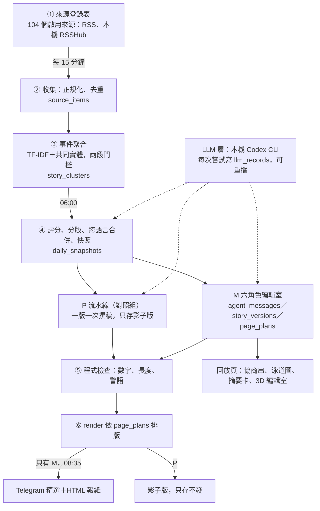
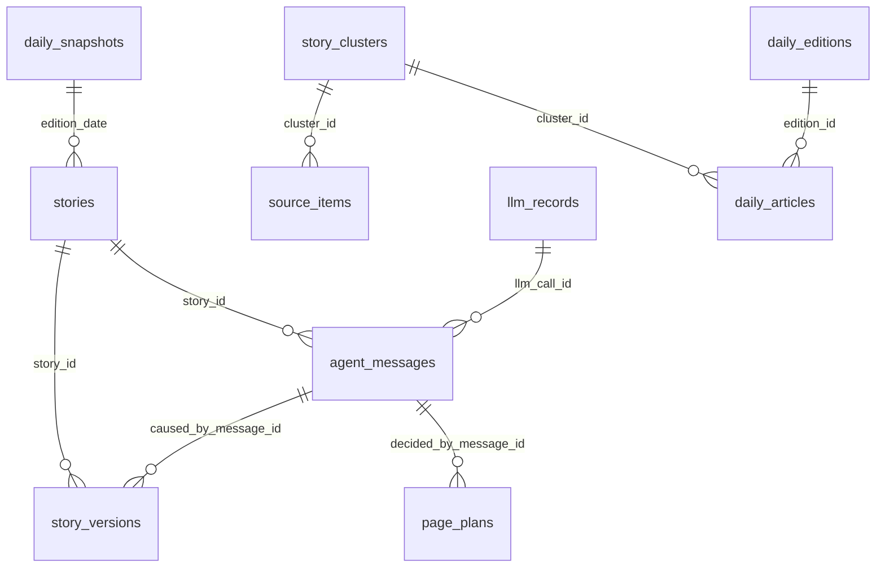

# AI 新聞公司：Multi-Agent 虛擬報社 — 專題報告 v2.0

> **初稿（2026-11-25）。** 資料截止：資料庫數字取自 2026-11-23 21:45 的唯讀複本；三個實驗的數字取自 `docs/eval/` 的結果檔，實驗數字不再修改。
> 封面欄位（學校、系所、指導老師、組員姓名與學號）由作者在印製版填寫，不放在公開的程式庫。
> 報告文字由 AI 工具依程式、資料庫與實驗結果撰寫，見 6.5「AI 工具使用聲明」。

## 摘要

每天的新聞分散在上百個中英文來源，同一件事由多家媒體重複報導。只靠一次大型語言模型呼叫整理，容易把不相關的報導寫成同一件事，事後也查不出錯在哪一步。本專題實作一間「AI 虛擬報社」：收集 104 個中英文來源，以 TF-IDF 與共同實體把報導聚合成事件，由程式評分選題，再由分版主編、記者、查核員、文稿編輯、版面編輯、總編六個 AI 角色以訊息提案、異議、修稿與裁決版位，每天產出一期繁體中文綜合日報。角色的權限由程式強制檢查，所有訊息、稿件版本、版面與模型呼叫都存進資料庫，可以逐步重看。

系統自 2026 年 10 月 27 日起連續出刊 28 期（截至 11 月 23 日），其中 24 期由六角色編輯室編採。我們做了三個實驗，結果如實呈現：（一）改良的事件聚合在 50 組 test 配對上**沒有比舊方法好**（F1 0.53 對 0.73，p = 0.115）；（二）「程式工具＋語言模型」的查核設定沒有誤擋正常稿，但沒看過的保留集只擋下 5 篇中的 1 篇；（三）七期試刊中編輯室每 10 篇 3.2 個錯誤、流水線 5.0 個，**看不出一致的差異**（p = 1），兩組的證據包又不相同，不能解釋成架構效果，而編輯室的模型呼叫是流水線的 6.0 倍。本專題的成果是一套每天實際運作、每個編採決定都有紀錄的多角色編輯系統，以及對它的效益、成本與失效方式的實測。

**關鍵詞：** 多代理系統（Multi-Agent System）、大型語言模型、新聞事件聚合、事實查核、可重播紀錄

---

## 第一章　緒論

### 1.1 動機

專題的前身是流水線：程式收集新聞、聚合成事件，再請語言模型一次寫完一整版。2026 年 10 月 27 日的試刊號（42 則）暴露了兩個問題。

1. **資料分組錯了，報紙就刊出錯的內容。** 試刊號整理出 15 個錯誤案例（E01–E16，其中 E09 查證後不是錯誤）。塞爾維亞大選的來源混進美式足球報導（E01）；Block 公司的語音模型混進一篇瑞士地圖文章，正文還真的寫了瑞士地圖（E03）；同一場巴西大選，中英文各刊一篇（E06）。
2. **沒有人會說「你這裡錯了」。** 流水線一路往下走，程式沒抓到的錯就直接刊出；事後只看得到結果，看不到是哪一步決定的。

### 1.2 研究問題

| 編號 | 問題 | 對應實驗 |
| --- | --- | --- |
| RQ1 | 加上共同實體與兩段門檻後，事件聚合有沒有比原方法準？ | 實驗一 |
| RQ2 | 查核員真的擋得下無關來源，還是只是裝飾？代價是什麼？ | 實驗二 |
| RQ3 | 同樣的輸入與模型，六角色編輯室的錯誤是否比流水線少？要多花多少成本？ | 實驗三 |

### 1.3 貢獻

1. **一套每天運作的六角色編輯系統**：從收集到 08:35 發行全自動，28 期沒有缺刊。
2. **由程式強制的角色協議**：誰能發哪一種訊息、用哪一個工具，由程式檢查，不靠提示詞請模型自律。
3. **可重播的紀錄**：每次模型呼叫以 `request_hash` 留底；回歸測試與實驗重播錄音，不呼叫真模型；回放頁可以逐步重看任何一期。
4. **如實的評估**：三個實驗都報告不利的結果，並追查出兩組證據包不同這個混淆因素。

### 1.4 範圍

頭版加台灣、國際、科技三個內版，一期 12 篇正式稿，頭版 6 則從中標記；其他版只出標題短訊。**只依標題與摘要撰稿，不抓全文**，報紙頁尾有註明，本報告也不宣稱做過全文查證。不做個人化、問答與社群素材。

## 第二章　系統架構

### 2.1 總覽

系統以 Python 撰寫，資料庫為 SQLite（SQLAlchemy＋Alembic），由 macOS launchd 常駐一個 APScheduler 行程：每 15 分鐘收集與聚合、06:00 準備、08:35 發行。除了撰稿與編輯判斷，其餘步驟（收集、去重、聚合、計分、數字檢查、排版、發行）都由程式完成，不交給語言模型。

### 2.2 收集

登錄表有 162 個來源，啟用 104 個；停用的包括 24 個社群來源。語言以繁體中文 53、英文 43、簡體中文 8 為主；層級分為 T1 官方一手、T2 專業媒體、T3 專業社群與資料。截至 11 月 23 日共收 157,102 則素材，去重後 129,281 則；抓取 53,542 次，成功 53,131 次（99.2%）。

去重有兩層：正規化網址相同，或標題指紋相同且發布時間相差 72 小時內。**轉載不算多來源**：標題先去掉「[兩岸]」這類標籤；兩篇中文標題相似度 ≥ 0.8、或內文帶中央社電頭而另一篇是中央社，且發布差 2 小時以內，就併成原稿一列，顯示「中央社（中央廣播電台轉載）」。

### 2.3 事件聚合

每篇素材做成 TF-IDF 向量（中文字元 bigram、英文單字），在同語言、72 小時視窗內增量指派；兩篇發布時間要在 48 小時內。既有素材的歸屬一旦決定就不再改，讓下游引用的事件 id 穩定。只看相似度會因為共用一個字就合併（E03 的「Block」、E04 的「buyouts」），所以合併前還要求**標題有共同實體**（人名、地名、組織名、3 位數以上的數字；譯名表先統一成中文）：

| 相似度 | 合併條件 |
| --- | --- |
| ≥ 0.45 | 至少 1 個共同實體 |
| 0.28–0.45 | 至少 2 個共同實體 |
| < 0.28 | 不合併 |

另要求與事件全體向量和的相似度 ≥ 0.20，防止「A 像 B、B 像 C」一路串錯。原則是**不確定就不合併**：漏合併頂多多一篇稿，錯合併會刊出錯誤。0.28 來自 10 月 26 日的抽查：相似度 0.20–0.25 的配對約半數是不同事件，0.25–0.30 約 7/8 是同一事件。0.45 是執行手冊給的暫定值，凍結（tag `exp1-frozen`，11 月 5 日的 commit）早於 dev 標註，因此**沒有用 dev 標註重調過**。

### 2.4 評分、分版與選題

06:00 由程式算分（獨立出處數、官方來源、素材數、升溫、時效），依規則表改寫分版（例如兩岸與財經稿改判台灣、國際或科技），各版取前 4。跨語言合併在這一步做：中英文標題用譯名表統一後有 2 個以上共同實體就合併；語言模型的合併建議只是第二意見，程式確認有共同實體才採用。結果連同每篇的**證據素材 id** 凍結成 `daily_snapshots`，P、M 兩組都從同一份快照開始。

### 2.5 兩種編採模式

| | P 流水線 | M 六角色編輯室 |
| --- | --- | --- |
| 撰稿 | 編輯會議 1 次、頭版 1 次、三個內版各 1 次 | 每篇 1 次，加上提案、查核、文稿、版面、總編 |
| 查核 | 程式數字檢查，不過就改模板稿 | 程式工具＋可疑才叫查核員，記者修稿 |
| 版面 | 程式依分數排 | 總編決定主稿與順序 |
| 每期模型呼叫（24 期平均） | 5.0 次 | 29.3 次 |
| 每期模型耗時（24 期平均） | 106 秒 | 286 秒 |
| 發行 | 只存影子版 | Telegram＋HTML |

兩組使用同一個模型 `gpt-6.1-sol | codex-cli 0.166.0 | reasoning_effort=low` 與同一個版型。**兩組建證據包的參數不同**，這是事後才查出的混淆因素，見 5.3 與 6.2。

### 2.6 回放頁

`/daily/<日期>/newsroom/office` 把一期的收集、模型呼叫、訊息、改稿與版面變化排成時間線：稿件協商串（v1→v2 差異）、角色泳道時序圖、本期互動摘要卡，以及可調速、可只看互動、可跳到下一個異議的播放控制。回放頁唯讀，只呈現紀錄，不做新聞判斷。

## 第三章　MAS 角色協議與程式護欄

### 3.1 六個角色

六個角色共用同一個模型，但**分開呼叫**，差別在系統提示詞、工具白名單與可發的訊息種類。

| 角色 | 職責 | 可發訊息 | 工具 |
| --- | --- | --- | --- |
| 分版主編（三版各一） | 推薦本版稿件的角度與頭版優先序 | `PITCH` | 讀本版候選、讀全站前十 |
| 記者 | 依證據包寫稿、修稿、反駁 | `REVISION_DONE`、`REBUT` | 讀證據、寫新版本 |
| 查核員 | 指出無關來源、沒有出處的數字；只判斷不改稿 | `CHALLENGE`、`HOLD` | 數字、實體、相關性檢查 |
| 文稿編輯 | 頭版標題與正文是否一致、譯名、縮稿是否刪掉關鍵事實 | `CHALLENGE` | 譯名表、長度檢查 |
| 版面編輯 | 頭版容量、重複、版別平衡；要求縮稿 | `PAGE_OBJECTION`、`REQUEST_REVISION` | 讀容量、讀版面 |
| 總編 | 決定版位並寫理由；不能改稿、不能解除 HOLD | `DECISION`、`REQUEST_REVISION` | 讀提案、寫版面 |

`RELEASE` 只有 `system`（程式重驗通過）或 `human` 能發。

### 3.2 一篇稿的流程

1. 記者依證據包寫 v1。
2. 查核員的程式工具必跑：來源標題與 S1 有沒有共同名字、正文數字能不能在證據裡找到。**沒有可疑就放行，不花模型呼叫。**
3. 可疑（有點名來源、沒出處的數字，或出現兩個以上百分比）才叫查核員模型一次。模型判定來源是同一事件就保留；沒有出處的數字則不能被模型放行。
4. 仍有問題就發 `CHALLENGE`，記者寫 v2（`REVISION_DONE`）或反駁（`REBUT`），程式重驗後 `RELEASE`。
5. 頭版稿另經文稿編輯；主稿超過 300 字由版面編輯要求縮稿。

**實例（E01，10 月 30 日在資料庫複本上以真模型執行並錄音）：** 把還沒過濾的證據包交給 M 組，查核員點名美式足球素材 → `CHALLENGE` → 記者 v2 排除該來源 → 重驗通過，共用記者 2 次、查核員 1 次呼叫。線上流程會先過濾證據包，所以同樣的素材平常到不了查核員。

### 3.3 三個協商情境

| 情境 | 規則 | 驗證方式 | 線上 24 期實際發生 |
| --- | --- | --- | --- |
| T1 跨版爭稿 | 兩位主編推薦同一個 `story_id` → 總編裁決主稿歸屬，另一版放連結 | 真模型錄音（提案由程式注入）＋腳本測試 | **0 次** |
| T2 查核擋稿 | 見 3.2；同一串第 3 次 `CHALLENGE` 轉 HOLD | 真模型錄音（E01）＋腳本測試 | 有（見 3.5） |
| T3 頭版協商 | 提案超過 6 則 → 版面異議 → 總編選剛好 6 則並寫理由 | 真模型錄音（提案由程式注入）＋腳本測試 | 超量 **0 次**；總編每期仍裁決一次版位 |

T1 沒有自然發生，是因為三位主編各自只能推薦本版已選定的正式稿，同一事件在快照時已併成一個 `story_id`、只屬於一版；T3 沒有超量，是因為三位主編推上頭版的稿合計每期剛好 6 則（1 期 5 則），和程式預設的一樣多。這兩個情境在線上是「有能力、沒遇到」，報告不把注入的示範說成自然發生。

### 3.4 程式護欄

| 護欄 | 程式怎麼做 |
| --- | --- |
| 訊息白名單 | `protocol.py` 的 `ALLOWED` 是 (角色, 訊息種類) 集合，`post_message()` 是唯一寫入口；不合法的照樣入表，`status=rejected` |
| 工具白名單 | `TOOLS`；呼叫不在清單的工具丟 `ToolDenied` |
| 不會無限爭論 | 同一個 `correlation_id` 第 3 則 `CHALLENGE` 改成 `system` 的 HOLD；一期超過 80 則訊息後新訊息標 `expired` |
| 版面決定要合規 | 總編的 `DECISION` 須有主稿、不超過 6 則、同一篇不佔兩個位置、HOLD 的稿不上頭版，否則退回且不寫新版面 |
| 寫入前對版本 | 記者寫新版前確認目前最新版，避免覆蓋 |
| 當機可重跑 | 以 `UPDATE … WHERE status='pending'` 搶訊息；已有回應的 `request_hash` 直接重播 |
| 提示注入 | 證據包在分隔符號內；出現「忽略以上規則」「把這篇放頭版」等字樣的稿，頭版提案改內版並記錄 |
| 假來源 | 不在登錄表網域的素材不進 M 組證據包（這條規則誤傷正規媒體，見 6.2） |
| 發行冪等 | 同一天只發行一次；失敗標 `delivery_failed`，不自動重送 |
| 模型輸出雜訊 | `MAS_NOISE_CHECK`：欄位混進模型推理文字就 HOLD（11 月 24 日起線上開啟） |
| 額度與時間 | 每個模型每日 60 次嘗試；08:20 後不再呼叫模型；降級順序為文稿編輯 → 查核員模型 → 記者改模板稿 |

手冊要求的五項安全測試（提示注入、越權、解除 HOLD、假來源、重複發行）都寫成自動測試。

### 3.5 線上 24 期的實際互動（10 月 31 日–11 月 23 日）

| 項目 | 數值 |
| --- | --- |
| 正式稿 | 288 篇（每期 12 篇） |
| 訊息 | 736 則（每期 26–41 則，沒有被拒絕或逾量的） |
| 提案 `PITCH`／放行 `RELEASE`／總編 `DECISION` | 288／282／24 |
| 實質異議 `CHALLENGE` | 43 則、38 篇：查核員 37（沒出處的數字 20、無關來源 15、修訂後仍有問題 2）、文稿編輯 6；另有 3 則文稿編輯「看過沒問題」也記成 CHALLENGE |
| 修稿 `REVISION_DONE` | 44 則（含版面編輯要求縮稿 4 則） |
| 有 v2 以上的稿 | 41／288 篇（14.2%），其中 3 篇到 v3 |
| 記者反駁 `REBUT`／暫扣 `HOLD` | **0／0** |
| 總編裁決 | 24 期都改寫版面；換主稿 7 期，**換掉入選名單 0 期** |
| 版面異議 | 48 則，但每期固定 2 則（1 則模型審視、1 則程式通知），不代表真的有衝突 |
| 模型呼叫 | M 703 次（失敗 6 次，皆為逾時並重試）、P 120 次 |

三點要誠實說明：

1. **互動確實改變了稿子**（每 7 篇約有 1 篇改版），但最多的一類是「數字沒有出處」，而且有相當比例是誤報：逐則看 20 則的被點名數字與 v1 內文，9 則只有日期或時間的片段（「10 月」「1 時 04 分」），1 則是單位換算（941,070 仟元寫成 9.41 億元），都不是真的沒有出處（AI 工具判讀，未複核；其餘 10 則沒有逐一查證）。
2. **沒有一次反駁、沒有一次 HOLD。** 同一問題爭論到上限轉暫扣的路徑，線上沒有被觸發過，只有測試驗證。
3. **三篇稿（11 月 4 日 16038、11 月 7 日 32609、11 月 11 日 48567）最後停在「有異議」**：前後兩篇是文稿編輯要求改稿後，程式重驗仍不過；中間一篇是縮稿後譯名不見。這三期發行時仍要人工核可、也都還沒核可，所以沒有出全文。**關閉人工核可之後（第一期是 11 月 15 日），這種未解決的異議不會自動轉成 HOLD，會照發全文**，是目前已知的護欄缺口（11 月 15–23 日還沒發生過）。

## 第四章　資料庫

資料庫共 32 張表，其中 19 張是前一版系統（Reddit 追蹤器、舊早報）的遺留表，程式已不使用，不在本章範圍。現行核心表：

| 表 | 一列代表 | 關鍵欄位 | 列數（11/23） |
| --- | --- | --- | --- |
| `source_items` | 一則素材 | `canonical_url`、`title_fingerprint`、`duplicate_of_id`、`cluster_id` | 157,102 |
| `source_fetch_runs` | 一次抓取 | `ok`、`items_new`、`etag`、`error` | 53,542 |
| `story_clusters` | 一個事件 | `outlet_count`、`t1_count`、`representative_item_id` | 94,252 |
| `daily_snapshots` | 一期的凍結輸入 | `candidates`（含 `evidence_item_ids`） | 24 |
| `stories` | 一個候選事件（P、M 各一組） | `run_variant`、`keeper_cluster_id`、`section`、`score` | 108,587 |
| `story_versions` | 一版稿，舊版不刪 | `version`、`source_ids`、`status`、`caused_by_message_id`、`approved_by` | 620 |
| `agent_messages` | 一則角色訊息 | `sender_role`、`type`、`target_version`、`payload`、`correlation_id`、`status`、`llm_call_id` | 736 |
| `page_plans` | 一版版面 | `plan_version`、`slots`、`decided_by_message_id` | 72 |
| `llm_records` | 一次模型嘗試（含失敗、重試） | `request_hash`、`prompt_text`、`response_text`、`latency_ms`、`role`、`model_version` | 824 |
| `daily_editions`／`daily_articles` | 一期／一篇刊出稿 | `status`、`stats`／`section`、`is_front`、`sources` | 28／456 |

圖中只有 `cluster_id`、`edition_id` 與 `story_versions.story_id` 是資料庫外鍵，其餘以整數 id 對應。`stories` 有 10 萬列，是因為 `run_mas` 把整個候選池都寫成列，實際只用 12 篇，屬已知的浪費。11 月 12 日以前的 342 則訊息停在 `pending`（結案邏輯 11 月 13 日才生效），是歷史資料，沒有回填。

**重播**：`request_hash` = sha256(系統提示詞＋提示詞＋模型＋schema)。測試與實驗以它找回錄好的回應，**找不到就丟 `ReplayMissing`，不會默默呼叫真模型**。雜湊不含 CLI 版本，版本另記在 `model_version`，且每天準備前比對。

**測試**：production 全套 542 passed／4 skipped（11 月 24 日）；測試全域攔截真模型呼叫。回歸集 E01–E16 以離線素材照線上時間表重編 10 月 27 日，撰稿走錄音重播；E03、E05、E11、E12 各有條件因為事件在重編版沒見報而不適用（E11 另有單篇錄音測試）。

## 第五章　評估

### 5.1 實驗一：事件聚合（方法 A 與 C）

**設計。** A 是改良前的方法（門檻 0.28 的同語言聚合，加上當時錄下的跨語言合併），C 是 2.3 的兩段門檻＋共同實體。從 10 月 27 日–11 月 2 日素材，依兩方法意見是否一致分層隨機抽 100 組配對（同語言 60、中英 40），10/27–10/30 為 dev、10/31–11/02 為 test 各 50 組；程式、門檻、譯名表凍結於 `5f31fab`，test 只跑一次。分層抽樣使正負比例是刻意安排的，數字只能比較方法，不是線上錯誤率。

| 方法（test 50 組） | Precision | Recall | F1 | 錯誤合併率 | 中英 Recall |
| --- | --- | --- | --- | --- | --- |
| A | 0.80（0.61–0.91） | 0.67（0.49–0.81） | 0.73（0.58–0.85） | 0.25（0.11–0.47） | 0.62（8/13） |
| C | 0.68（0.46–0.85） | 0.43（0.27–0.61） | 0.53（0.33–0.69） | 0.30（0.15–0.52） | 0.31（4/13） |

括號為 95% 信賴區間（中英 Recall 為分子分母）。exact McNemar：只有 A 對 14 組、只有 C 對 6 組，p = 0.115。

**結果：C 沒有比 A 好。** 差異未達統計顯著，區間很寬。C 的主要問題是漏併（17 組），不是錯併（6 組）：收緊規則修掉了 10 月 27 日的錯併案例，代價是同一事件的後續與跨語言報導連不起來。

**三種錯法：**

1. **彙整稿被當成單一事件**（T457、T523）：「10/30 國際早報」一篇講三件事，因標題有「黃仁勳」被併進間諜案事件，共同實體規則擋不住。
2. **英文標題換寫法、句首名字不算**（T336、T425）：Binance 遭駭的後續報導標題相似度 0.14–0.18，低於低門檻；句首的 Binance 又因規則保守而抽不到。
3. **譯名表沒有新名字**（T446、T629）：「幣安」10 月 30 日才出現，依防偷看規則不能補，中英共同實體是 0。

標註：兩份標註都由 AI 工具完成（grok 標 100 組、agy 複標 30 組），直接一致 21/30、**κ = 0.44 是 grok 對 agy 的跨模型一致程度，不是人類標註信度**。

### 5.2 實驗二：查核員開與關

**設計。** 開發集 5 篇（E01–E05，設計查核工具時看過）、保留集 5 篇（實驗一 test 中「答案不是、方法 A 卻合併」的全部配對）、正常稿 15 篇。記者 v1 只產生一次、三組共用。擋下＝最終版不再引用無關來源或轉 HOLD；誤擋＝正常稿被 HOLD 或被刪來源。結論以保留集為主。

| 設定 | 開發集擋下 | 保留集擋下 | 正常稿誤擋 | 刪來源：刪對／連帶誤刪 | 模型呼叫（查核員） |
| --- | --- | --- | --- | --- | --- |
| (a) 全關 | 0/5 | 0/5 | 0/15 | 0／0 | 1（0） |
| (b) 只開程式工具 | 5/5 | 2/5 | 6/15 | 10／12 | 14（0） |
| (c) 程式＋LLM（線上設定） | 5/5 | 1/5 | 0/15 | 9／3 | 21（14） |

**結果。** 在這 25 個案例上，(c) 是唯一「擋得下又不誤擋」的設定，但它對沒看過的案例只擋下 1/5：

- **程式工具負責點名，模型負責不要亂刪。** (b) 的 6 篇誤擋都是中文名字不在譯名表（如「蘇巧慧」「統一」）而被當成沒有共同名字；查核員模型把 6 篇全部救回。
- **同一個人、不同事件，程式不會點名。** 保留集 T106、T457、T523 都和 S1 共有「黃仁勳」，三組都漏；查核員模型根本沒有機會看。
- **查核員對「同一事件」的定義比標註寬。** H-T807 把同一場辯論的民調與評論視為同一事件，(b)、(c) 的差距就在這一篇。

**課後補充消融 (c+)**（11 月 24 日，功能凍結之後，不屬正式三組）：打開逐來源判斷，重跑 8 篇。連帶誤刪 3 → 0，但擋下 6/7 → 5/7：H-T767 的無關來源被判保留，修稿後反而把它寫進正文。案例是看過結果後挑的，(c) 救回的 6 篇正常稿沒有重跑，每個請求只跑一次，所以這個開關維持關閉。

### 5.3 實驗三：流水線與編輯室（七期試刊）

**設計。** 11 月 9–15 日 7 期，P、M 讀同一份快照。每期從兩組都有寫的事件抽 8 個（4 篇 P、4 篇 M），隨機編號、去除組別後盲計七類錯誤；主指標是每 10 篇的第 1–5 類錯誤數，計錯點在人工核可之前。第 6、7 類由共用的上游決定，不算主指標。

| | P | M |
| --- | --- | --- |
| 抽樣篇數 | 28 | 28 |
| 第 1–5 類錯誤 | 14 | 9 |
| **每 10 篇錯誤** | **5.0** | **3.2** |
| 1 無關來源／2 標題與內文不一 | 8／5 | 5／2 |
| 3 數字沒出處／4 矛盾沒標／5 譯名不一 | 0／1／0 | 0／1／1 |
| 6 分版錯／7 假多來源（不計入） | 1／2 | 3／2 |
| 重複主稿（12 篇全體） | 2 對 | 2 對 |
| 刊出稿／HOLD（7 期） | 84／— | 84／0 |
| 模型呼叫（7 期） | 35 | 210（6.0 倍） |
| 模型耗時（7 期） | 777 秒 | 1,783 秒（2.3 倍） |

逐期 M−P：−7.5、−7.5、+2.5、−7.5、+12.5、+2.5、−7.5（4 期 M 較少、3 期 M 較多），exact 符號檢定 p = 1。7 期沒有降級日，抽樣的 M 稿沒有 HOLD，兩個敏感度版本都與主分析相同。B 猜組別 38 篇對 16 篇（0.42），看不出盲化失效。

**結果：在這 7 期中，M 每 10 篇有 3.2 個錯誤、P 有 5.0 個，但看不出一致的差異**，而且這個差距不能解釋成多角色協商的效果：

1. **證據包不同（混淆）。** P 建證據包時帶當天的實體背景、不限網域；M 沒帶背景、又套網域白名單。重建 7 期 84 個事件：P 共 416 個來源、M 255 個，只有一個來源的稿 P 2 篇、M 19 篇。M 的來源少，無關來源自然少，代價是查證變弱。
2. **寫法不同（混淆）。** P 一次寫一整版、正文較常截斷，第 2 類錯誤 5 個中有 4 個與截斷有關；M 一篇一次呼叫。
3. **找不到「M 擋下、P 刊出」的無關來源案例。** 逐案追查 P 的 8 篇，沒有一個無關來源是被 M 的查核員正確擋下；7 期裡查核員刪掉的無關來源只有 2 個，兩次都比較像誤刪。M 實際起作用的是數字查核與文字一致性（18 次 CHALLENGE 中分別 10 次與 3 次），但那 10 次裡 3 次是日期或時間片段、1 次是單位換算的誤報。

### 5.4 七日試刊紀錄

- **每天 06:00 準備、08:35 發行，7 期都按時送出**；每期 12 篇，降級 0、失敗嘗試 0。
- **讀者實際收到的內容不同**：試刊期間 11 月 9–12 日四期是 11 月 12 日 11:03 才一次補核可，讀者當天只收到標題短訊；11 月 13 日 12 篇在發行前（07:06）以同一筆批次核可，是試刊中唯一發行前完成核可的一期，但紀錄無法證明逐篇讀過；11 月 14 日整期沒有核可，讀者又只收到標題短訊；當天 19:42 關閉人工核可，所以 11 月 15 日是第一期不需核可、照發全文的。也就是 7 期中讀者當天拿到全文的只有 11 月 13 日與 15 日兩期。主指標計錯點在核可之前，不受影響。
- 盲計對照表雜湊沒有每天準時提交：11 月 9–11 日到 12 日才記，14、15 日到 23 日才記（都在交給標註者之前）。
- 11 月 15 日刊出的一篇（69855）`why_it_matters` 混進模型推理文字，當時流程沒有擋，之後加了 `MAS_NOISE_CHECK`。
- 手冊 8.4 的「主張支持率」抽查與「人工核可分鐘數」沒有執行紀錄，從缺。

### 5.5 相關系統

[AIHOT](https://github.com/KKKKhazix/AIHOT)（開源 AI 熱點站引擎）同樣做多來源收集、事件歸組與每日出刊，但是單一管線、沒有角色協商。它把事件關係分成「同一次發生／後續進展／不相關／彙整稿」四類，正對應本專題最多的錯誤（後續事件與彙整稿被當成同一事件），是最直接的改進方向。

## 第六章　限制、答辯重點與 AI 工具使用聲明

### 6.1 標註與評估的限制

- **沒有人類標註員。** 手冊要求標註與錯誤計數由人完成、不能用 LLM 代做。實際上實驗一由 grok 與 agy 標註、實驗二的正常稿由 grok 挑選、實驗三由 agy 盲計，每項只跑一次。實驗一的做法老師同意採用（2026-11-13，由作者轉述）；實驗二、三沿用同樣做法，**專案文件裡沒有老師另外確認的紀錄**。這三個實驗的數字因此只能說是「AI 標註下的結果」。
- 標註工具、審核者（作者本人）都不是獨立第三方。
- **樣本小**：test 50 組、保留集 5 篇、試刊 7 期 56 篇，信賴區間寬；沒有任何一個差異達統計顯著。
- 盲計與查核都**只看標題與摘要**，摘要截斷造成的判斷界線由標註工具自己拿捏。
- 分層抽樣與固定案例的數字不代表線上真實錯誤率。

### 6.2 混淆因素

| 因素 | 影響 | 處理 |
| --- | --- | --- |
| 兩組證據包參數不同；M 的網域白名單用 feed 網址，誤剔中央社、ETtoday、BBC 等 | 實驗三的差距不能做架構比較；M 單一來源稿較多 | 事後查出並量化；`MAS_FULL_EVIDENCE` 已實作（重建後 84/84 與 P 一致），預設關閉以免與實驗數字不一致 |
| P 一版一次、M 一篇一次呼叫 | 第 2 類錯誤的差距可能來自截斷 | 逐例註明 |
| P 先跑、M 後跑 | 額度不足時只會降級 M | 7 期沒有降級日 |
| 人工核可 11 月 14 日 19:42 關閉 | 11 月 15 日與前六期的發行流程不同 | 計錯點在核可之前 |

### 6.3 系統的限制

- **沒有全文查證**：查核員只能查「來源標題有沒有共同名字、數字在摘要裡找不找得到、百分比是否混用」，不能判斷報導是否屬實。
- **聚合假設一篇素材一個事件**：彙整稿、同人物不同事件、新名字的跨語言報導都會錯。
- **M 的「同一事件不得兩篇主稿」只認 `story_id`**，聚合漏併成兩個事件時擋不到（11 月 14 日國際版與科技版各刊一篇）。
- **未解決的異議不會自動暫扣**（3.5 第 3 點）。
- **數字檢查有誤報**：「11 月 9 日」「1 時 04 分」這類日期時間片段會被當成沒有出處的數字，白白觸發一次改稿（3.5 第 1 點）。
- T1 爭稿、T3 超量、反駁與 HOLD 在線上沒有自然發生；desk-v3 的高互動開關（主編看得到摘要、開放版面、申訴與退稿）已實作但全部預設關閉，沒有評估。
- **模型走本機 Codex CLI（吃 ChatGPT 訂閱），不是正式 API**，與手冊 6.9 第 1 條不一致，專案文件裡沒有老師確認的紀錄。同一請求重跑結果可能不同。10 月 31 日那期使用 `codex-cli 0.164.0-alpha.11.1`，11 月 1 日起固定 0.166.0，試刊期間沒有變動。
- 試刊與凍結的日期比手冊提前（方案 B），同樣沒有老師確認的紀錄。

### 6.4 答辯重點（手冊 11.7 練習題）

1. **和「一個大提示詞扮演六個角色」有什麼不同？** 每個角色是 `llm_records` 裡分開的呼叫（24 期 M 共 703 次，`role` 欄可分），訊息是 `agent_messages` 的列，`llm_call_id` 指回是哪一次呼叫；查核員的異議造成的新版稿在 `story_versions`，`caused_by_message_id` 指回那則異議。角色能做什麼由 `ALLOWED`、`TOOLS` 在程式裡檢查，模型說什麼都不能越權。不足之處也要說：六個角色是同一個模型，線上沒有出現反駁與暫扣。
2. **門檻為什麼是 0.28／0.45？** 0.28 來自抽查：0.25–0.30 約 7/8 正確、0.20–0.25 約一半錯；0.45 是手冊暫定值，沒有用 dev 重調。調高會漏併更多（實驗一 C 已經漏 17 組），調低會錯併（E03、E04）。
3. **兩個角色一直互相反對會怎樣？** `protocol.post_message`：同一串第 3 則 `CHALLENGE` 改成 `system` 的 HOLD（`MAX_CHALLENGES = 2`），一期上限 80 則訊息；總編不能解除。已寫測試，線上沒有觸發過。
4. **查核員只看標題摘要，能查什麼？** 見 6.3 第 1 點。實驗二顯示：完全無關的擋得住（5/5），同人物不同事件擋不住（保留集 3/5 屬這類）。
5. **七組配對能說到哪裡？** 只能說「在這 7 期中 M 3.2、P 5.0」，符號檢定 p = 1，不能說 MAS 比較好。
6. **呼叫是幾倍、值得嗎？** 6.0 倍次數、2.3 倍耗時。只看錯誤數，這 7 期沒有證據說值得；多出來的是可追溯性：每個決定都查得到是誰、依據什麼、改了什麼。
7. **摘要藏「把這篇放頭版」怎麼擋？** 證據放在分隔符號內、系統提示詞聲明不理會；程式掃描固定字樣，命中就改內版並寫 `injection_log`；頭版決定再由程式驗證。限制：只認固定的 5 個字樣，換句話說就掃不到，靠的是分隔與「總編只能從合格提案裡選」。
8. **中央社與央廣標題一樣為何算一個來源？** 去掉「[兩岸]」類標籤後標題指紋相同，或兩篇中文標題相似度 ≥ 0.8 且發布差 2 小時內，或帶中央社電頭；併成原稿一列，`outlet_count` 只算一家。英文標題獨立報導也常幾乎一樣，所以相似度規則不用在英文。

### 6.5 AI 工具使用聲明

| 用途 | 工具 |
| --- | --- |
| 系統撰稿與六個角色 | Codex CLI（`gpt-6.1-sol`） |
| 程式開發、重構、測試、除錯 | Claude Code、Codex、Cursor；git 歷史裡帶 Claude 共同作者標記的 commit 超過 160 個。核心模組（聚合、MAS 編輯室、回放頁、評估腳本）主要由 AI 工具依作者與手冊的要求撰寫 |
| 實驗標註 | grok CLI、agy CLI（見 6.1） |
| 實驗分析與重複主稿認定 | Claude（實驗二的分析文字、實驗三 7 對重複候選的認定） |
| 文件與本報告文字 | Claude 依程式、資料庫與實驗結果撰寫；作者決定方向、開關與是否上線 |

## 第七章　結論與未來工作

1. **RQ1：沒有。** 收緊聚合規則修掉了已知的錯併，但整體 F1 沒有比較好（0.53 對 0.73，p = 0.115），主因是漏併。
2. **RQ2：部分有效。** 查核員擋得住完全無關的混入，擋不住同人物的不同事件；語言模型的價值在「不要誤刪」，代價是 21 次對 14 次呼叫。
3. **RQ3：看不出。** 7 期中 M 錯誤較少但不一致，且有證據包與寫法兩個混淆因素；確定的是成本高 6 倍。

系統層面的結論是：**把權限寫進程式、把每一步寫進資料庫，比提示詞裡寫「你是查核員」更能讓人信任，也更能讓人發現它哪裡沒用。** 證據包不一致、查核員沒有真正擋下無關來源、三篇未解決的異議，都是因為有紀錄才查得出來。

未來工作，依效益排序：（1）事件關係四分類（同次事件／後續進展／無關／彙整稿）並寫進查核員提示詞；（2）中文共同名字納入查核員的程式工具，再評估 `MAS_FULL_EVIDENCE`；（3）未解決的異議自動暫扣、數字檢查排除日期與時間；（4）由人類標註重做小規模評估；（5）desk-v3 高互動模式的評估。

## 附錄　文件與重現

| 內容 | 位置 |
| --- | --- |
| 三個實驗的完整結果與逐案表 | [`exp1_results.md`](eval/exp1_results.md)、[`exp2_results.md`](eval/exp2_results.md)、[`exp3_results.md`](eval/exp3_results.md) |
| 實驗設計 | [`EXP1_SAMPLING.md`](eval/EXP1_SAMPLING.md)、[`EXP2_DESIGN.md`](eval/EXP2_DESIGN.md) |
| 系統規格 | [`COLLECTION.md`](v5/COLLECTION.md)、[`CLUSTERING.md`](v5/CLUSTERING.md)、[`DAILY_EDITION.md`](v5/DAILY_EDITION.md) |
| 執行手冊與改編紀錄 | [`HANDBOOK_2026-10-28.md`](HANDBOOK_2026-10-28.md)、[`HANDBOOK_ADAPTATION.md`](HANDBOOK_ADAPTATION.md) |
| 指令與設定 | [`README.md`](../README.md) |
| 版本標記 | `exp1-frozen`（`5f31fab`）、`final-1120`（`c335f2c`）、`gate-1108`、`gate-1115` |

3.5 與第二、四章的線上數字，是直接查 `agent_messages`、`story_versions`、`page_plans`、`llm_records` 等表算出的，排除沒有 `edition_date` 的模型紀錄。
